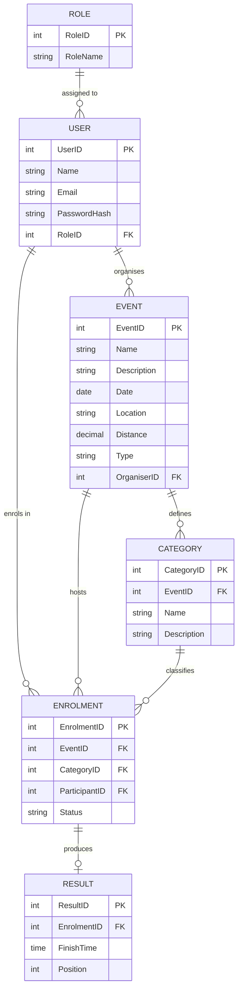

# RaceDay - Full-Stack Event Management Platform
## PROG6212 Portfolio of Evidence (PoE) — Part 2: RESTful API Development

---

### Student & Submission Information
- **Module Name:** Programming 2B (PROG6212 / PROG6212/w)
- **Student Name:** Lunga Njabulo Khumalo
- **Student Number:** ST10483560
- **GitHub Repository:** [https://github.com/Lunga012/RaceDay-POE-Part1.git](https://github.com/Lunga012/RaceDay-POE-Part1.git)
- **Video Presentation Link (YouTube):** [https://youtu.be/8a6NFXWOK9M](https://youtu.be/8a6NFXWOK9M) *(Unlisted YouTube Walkthrough)*

---

## 1. Project Overview & Background
South Africa is world-renowned for its road running, walking, and cycling culture—headlined by iconic ultra-marathons and races such as the **Comrades Marathon** between Pietermaritzburg and Durban, the **Cape Town Cycle Tour**, the **Soweto Marathon**, and the **Two Oceans Marathon**, alongside hundreds of local weekend park runs and community charity races.

Historically, race coordination has been encumbered by paper registration, disconnected spreadsheets, and cumbersome manual capture of finish times. **RaceDay** solves this challenge through a robust, cloud-aware, API-driven software architecture. 

In **Part 2**, the core backend RESTful Web API has been built using **ASP.NET Core Web API (C#)**, **Entity Framework Core (Code-First Approach)**, **SQL Server**, and **server-side session authentication** enforcing role-based permissions.

---

## 2. User Roles & Security Architecture

The platform enforces two distinct, non-overlapping user roles at the API level:

| Role | Responsibilities & Capabilities | Restrictions |
| :--- | :--- | :--- |
| **Organiser** | • Create, edit, and delete sports events (Name, Description, Date, Location, Distance, Type)<br>• Define and manage age and distance categories for each event<br>• View all participant enrolments across their created events<br>• Update participant enrolment statuses (`Pending`, `Confirmed`, `Cancelled`)<br>• Capture and edit finish times and finishing positions for participants | • Cannot enrol as a participant in events.<br>• Cannot modify or delete events owned by other organisers. |
| **Participant** | • Register an account and maintain profile information<br>• Browse upcoming road running, walking, and cycling events<br>• Enrol for an event under a specific category<br>• View personal enrolment history and current enrolment status<br>• Access personal race results (finish times and official finishing positions) across all completed events | • Cannot create, edit, or delete events or categories.<br>• Cannot view other participants' personal enrolments.<br>• Cannot capture official race results. |

### Authentication & Session Management
- **Password Security:** Passwords are cryptographically salted and hashed using **BCrypt** (`workFactor: 11`). Plaintext passwords are never persisted.
- **Session Management:** Upon successful login (`/api/auth/login`), the server instantiates an authenticated session storing the user's `UserID`, `Name`, `Email`, and `RoleName`.
- **Session Tokens & Cookies:** Authentication state is maintained via HTTP-only ASP.NET Core session cookies (`.RaceDay.Session`) and also supports the `X-Session-Token` / `Bearer` HTTP header for cross-platform integration and headless API testing.
- **Role Enforcement:** Custom `[SessionAuthorize]` attributes protect sensitive endpoints.
  - Unauthenticated requests receive **`401 Unauthorized`**.
  - Requests from unauthorised roles receive **`403 Forbidden`**.

---

## 3. Database Architecture (Entity Framework Core Code-First)

The Entity Framework Core model matches the approved Part 1 ERD and SQL script (`LN KHUMALO p1.sql`) with a minimum of six entities:



### Seeding Data
On application startup, `DbInitializer` verifies database connectivity and automatically seeds the database with the realistic South African sample dataset from `LN KHUMALO p1.sql`:
- **Roles:** `Organiser`, `Participant`
- **Users:** 2 Organisers (`Lunga Organiser`, `Njabulo Organiser`) and 2 Participants (`Sphe Participant`, `Sihle Participant`).
- **Events:** `Comrades Marathon` (89.0 km, Run), `Cape Town Cycle Tour` (109.0 km, Cycle), `Soweto Marathon` (42.2 km, Run).
- **Categories:** `Senior`, `Junior`, `Elite`, `Open`, `10km`, `21km`.
- **Enrolments & Results:** Enrolments with Confirmed/Pending statuses and official finish times (e.g. `06:45:00` - Position 47; `01:15:00` - Position 12).

---

## 4. RESTful API Endpoint Plan & Implementation

The following endpoints are fully implemented and visible through Swagger UI:

| HTTP Method | Route | Description | Role Required | Request Body | Expected Response |
| :--- | :--- | :--- | :--- | :--- | :--- |
| **POST** | `/api/auth/register` | Registers a new user account with role | None (Public) | `{ name, email, password, role }` | `201 Created` - User record & session token<br>`400 Bad Request`<br>`409 Conflict` (duplicate email) |
| **POST** | `/api/auth/login` | Authenticates user & initializes server session | None (Public) | `{ email, password }` | `200 OK` - User profile & session token<br>`401 Unauthorized` |
| **POST** | `/api/auth/logout` | Clears active server session | Any Authenticated | None | `200 OK` - Session ended |
| **GET** | `/api/auth/me` | Retrieves active user session data | Any Authenticated | None | `200 OK` - User session info |
| **GET** | `/api/profile` | Views authenticated user's profile | Any Authenticated | None | `200 OK` - Profile details<br>`401 Unauthorized` |
| **PUT** | `/api/profile` | Updates user profile and/or password | Any Authenticated | `{ name, email, newPassword? }` | `200 OK` - Updated profile<br>`409 Conflict` |
| **GET** | `/api/events` | Retrieves all upcoming events (optional filter by type) | None (Public) | None | `200 OK` - List of events |
| **GET** | `/api/events/{id}` | Retrieves details and categories for a single event | None (Public) | None | `200 OK` - Event details<br>`404 Not Found` |
| **GET** | `/api/events/my-events` | Retrieves events created by the logged-in organiser | Organiser | None | `200 OK` - Organiser's events<br>`403 Forbidden` |
| **POST** | `/api/events` | Creates a new event | Organiser | `{ name, description, date, location, distance, type }` | `201 Created` - Event details<br>`401 Unauthorized`<br>`403 Forbidden` |
| **PUT** | `/api/events/{id}` | Updates an existing event owned by the organiser | Organiser | `{ name, description, date, location, distance, type }` | `200 OK` - Updated event<br>`403 Forbidden`<br>`404 Not Found` |
| **DELETE** | `/api/events/{id}` | Deletes an existing event owned by the organiser | Organiser | None | `204 NoContent`<br>`403 Forbidden`<br>`404 Not Found` |
| **GET** | `/api/categories` | Retrieves all event categories | None (Public) | None | `200 OK` - List of categories |
| **GET** | `/api/categories/event/{eventId}` | Retrieves categories for a specific event | None (Public) | None | `200 OK` - List of event categories |
| **POST** | `/api/categories` | Adds a category to an organiser's event | Organiser | `{ eventId, name, description }` | `201 Created` - Category record<br>`403 Forbidden` |
| **PUT** | `/api/categories/{id}` | Updates a category | Organiser | `{ name, description }` | `200 OK`<br>`403 Forbidden` |
| **DELETE** | `/api/categories/{id}` | Deletes a category | Organiser | None | `204 NoContent`<br>`403 Forbidden` |
| **POST** | `/api/enrolments` | Participant enrols in an event under a category | Participant | `{ eventId, categoryId }` | `201 Created` - Enrolment record<br>`400 Bad Request`<br>`403 Forbidden`<br>`409 Conflict` |
| **GET** | `/api/enrolments/my-enrolments` | Views logged-in participant's personal enrolments | Participant | None | `200 OK` - Participant's enrolments<br>`403 Forbidden` |
| **GET** | `/api/enrolments/event/{eventId}` | Organiser views all enrolments for their event | Organiser | None | `200 OK` - All event enrolments<br>`403 Forbidden` |
| **PUT** | `/api/enrolments/{id}/status` | Organiser updates enrolment status | Organiser | `{ status: "Confirmed" }` | `200 OK` - Updated enrolment<br>`403 Forbidden` |
| **POST** | `/api/results` | Organiser captures finish time and position | Organiser | `{ enrolmentId, finishTime, position }` | `201 Created` - Result record<br>`400 Bad Request`<br>`403 Forbidden`<br>`409 Conflict` |
| **PUT** | `/api/results/{id}` | Organiser updates recorded finish time and position | Organiser | `{ finishTime, position }` | `200 OK` - Updated result<br>`403 Forbidden` |
| **GET** | `/api/results/my-results` | Participant views personal race results history | Participant | None | `200 OK` - Personal results history<br>`403 Forbidden` |
| **GET** | `/api/results/event/{eventId}` | Retrieves published results for an event | None (Public) | None | `200 OK` - Results leaderboard |
| **POST** | `/api/database/seed` | Administrative endpoint to re-seed sample data | None (Dev/Demo) | None | `200 OK` - Seed summary |

---

## 5. Swagger / OpenAPI Integration

Swagger UI is configured as the root landing page (`/` or `/swagger`) of the Web API:
- **XML Documentation:** Every endpoint, parameter, DTO, and HTTP status code has full XML documentation describing its purpose and validation constraints.
- **Interactive Authentication:** The Swagger UI includes an `Authorize` button supporting the `X-Session-Token` header. Testers can login via `/api/auth/login`, copy the `sessionToken`, and paste it into the Swagger authorization dialogue to execute authenticated Organiser or Participant requests seamlessly.

---

## 6. Comprehensive Unit Testing (35 Tests Passing)

The project includes an extensive unit test suite in `tests/RaceDay.Tests` covering all mandatory scenarios from the rubric:

1. **User Registration & Login (`AuthTests.cs`):**
   - `Register_WithValidOrganiserDetails_Returns201CreatedAndSession`
   - `Register_WithValidParticipantDetails_Returns201CreatedAndSession`
   - `Register_WithDuplicateEmail_Returns409Conflict`
   - `Register_WithInvalidRole_Returns400BadRequest`
   - `Login_WithValidCredentials_Returns200OkAndSessionToken`
   - `Login_WithIncorrectPassword_Returns401Unauthorized`
   - `Login_WithNonExistentEmail_Returns401Unauthorized`
   - `Logout_WhenAuthenticated_ClearsSessionAndReturns200Ok`
   - `Password_IsHashedWithBCrypt_AndNeverStoredInPlainText`

2. **Event Management (`EventManagementTests.cs`):**
   - `Organiser_CanCreateEvent_Returns201CreatedWithAllRequiredFields`
   - `Organiser_CanUpdateOwnEvent_Returns200OkWithUpdatedDetails`
   - `Organiser_CannotUpdateOtherOrganisersEvent_Returns403Forbidden`
   - `Organiser_CanDeleteOwnEvent_Returns204NoContent`
   - `Organiser_CannotDeleteOtherOrganisersEvent_Returns403Forbidden`
   - `GetAllEvents_PublicAccess_ReturnsAllEventsWithCategories`
   - `GetEventById_WhenNotFound_Returns404`

3. **Role-Based Access & Rejection (`RoleRejectionTests.cs`):**
   - `UnauthenticatedUser_AccessingProtectedEndpoint_Returns401Unauthorized`
   - `Participant_AccessingOrganiserOnlyEndpoint_Returns403Forbidden`
   - `Organiser_AccessingParticipantOnlyEndpoint_Returns403Forbidden`
   - `Organiser_AccessingOrganiserEndpoint_IsPermitted`
   - `Participant_AccessingParticipantEndpoint_IsPermitted`

4. **Event Enrolments (`EnrolmentTests.cs`):**
   - `Participant_CanEnrolInEventWithCategory_Returns201CreatedAndRecordsLink`
   - `Participant_EnrollingInSameEventTwice_Returns409Conflict`
   - `Participant_EnrollingInNonExistentEvent_Returns404NotFound`
   - `Participant_EnrollingWithCategoryFromDifferentEvent_Returns400BadRequest`
   - `Participant_CanViewMyEnrolments_ReturnsOnlyOwnEnrolments`
   - `Organiser_CanUpdateEnrolmentStatus_Returns200OkWithNewStatus`

5. **Race Results (`ResultTests.cs`):**
   - `Organiser_CanCaptureParticipantResult_Returns201Created`
   - `Organiser_CapturingResultWithInvalidTimeFormat_Returns400BadRequest`
   - `Organiser_CapturingResultForNonExistentEnrolment_Returns404NotFound`
   - `Organiser_CanUpdateExistingResult_Returns200Ok`
   - `Participant_CanViewPersonalResultsHistory_ReturnsOnlyOwnResults`

6. **User Profile (`ProfileTests.cs`):**
   - `AuthenticatedUser_CanViewProfile_Returns200Ok`
   - `AuthenticatedUser_CanUpdateProfile_Returns200Ok`
   - `AuthenticatedUser_UpdatingToExistingEmail_Returns409Conflict`

### Test Execution Summary
```text
Passed!  - Failed: 0, Passed: 35, Skipped: 0, Total: 35, Duration: 27 s - RaceDay.Tests.dll (net10.0)
```

---

## 7. CI/CD Workflow & Green Build

The repository is configured with an automated continuous integration pipeline in `.github/workflows/ci.yml`. On every `push` and `pull_request`, the workflow:
1. Validates repository structure (checks for `/docs` folder, ERD, and SQL script).
2. Restores NuGet dependencies.
3. Compiles the entire solution under `Release` configuration.
4. Executes all 35 unit tests and enforces that all tests must pass.

### CI/CD Green Build Screenshot


